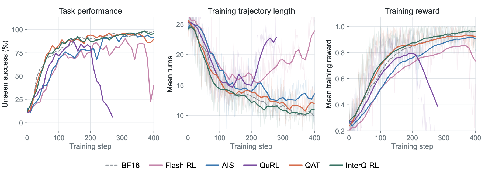

<p align="center">
  <picture>
    <source media="(prefers-color-scheme: dark)" srcset="imgs/title-dark.png">
    
  </picture>
</p>

<p align="center">
  <a href="https://arxiv.org/abs/2610.35303"></a>
  <a href="LICENSE"></a>
  <a href="https://github.com/verl-project/verl"></a>
  
</p>

InterQ-RL delivers **BF16-level agentic RL on a quantized rollout**, pairing an **FP8 W8A8
rollout and FP8 KV cache** with **interaction-aware execution correction**. It is built on
[verl](https://github.com/verl-project/verl).

## Overview

InterQ-RL works in three stages: it **aligns** the learner's numerics to the rollout's,
**corrects** along the state-reaching policy prefix, and **reallocates** that correction across
action segments under a fixed budget.


## Results

InterQ-RL is the **best quantized method on every metric**, across four agentic settings and
three model scales.

![End-to-end results. ALFWorld success 97.1 for the BF16 reference, 64.1 Flash-RL, 92.3 AIS, collapsed for QuRL, 90.4 QAT, 96.4 InterQ-RL. WebShop score and success: 78.0/54.0 BF16, 72.8/44.4 Flash-RL, 76.5/51.5 AIS, 75.3/51.7 QuRL, 74.9/49.7 QAT, 77.7/53.5 InterQ-RL. ScienceWorld 8B macro and solved: 66.9/74.1 BF16, 63.2/69.2 Flash-RL, 59.6/64.2 AIS, 57.1/63.9 QuRL, 65.5/75.8 QAT, 67.8/76.1 InterQ-RL. ScienceWorld A3B macro and solved: 67.0/74.3 BF16, 65.8/71.5 Flash-RL, 65.0/70.6 AIS, 64.0/69.6 QuRL, 69.3/76.6 QAT, 69.9/76.9 InterQ-RL.](imgs/results.png)

It stays **within 0.7 points of BF16** on ALFWorld and WebShop, and is **ahead of BF16** on both
ScienceWorld backbones.

It also stays **stable to the end of training**, while the other quantized methods degrade or
collapse.



And it solves tasks in **fewer interaction turns**: on ALFWorld the average successful trajectory
drops from 12.72 turns under QAT to 10.06.

## Setup

### Requirements

- 8 GPUs for the 4B and 8B settings, 2 × 8 for Qwen3-30B-A3B
- verl's official image `verlai/verl:vllm023.dev1` (CUDA 13.0, PyTorch 2.11.0, vLLM 0.23.0,
  transformers 5.3.0, Megatron-Core 0.16.1)
- Java 21 for ScienceWorld

### Install

Inside the image:

```bash
pip install --no-deps -e .
pip install -r requirements-interq.txt
pip install --no-deps megatron-bridge==0.3.1
```

### Environments

<details>
<summary><b>ALFWorld</b></summary>

```bash
alfworld-download
python agent_system/environments/alfworld/data_preprocess/process_alfworld.py \
    --input_dir ~/.cache/alfworld/json_2.1.1 --output_dir data/alfworld
```
</details>

<details>
<summary><b>WebShop</b></summary>

The environment server comes from [Agent-R1](https://github.com/0russwest0/Agent-R1) and listens
on `127.0.0.1:4111`. Download the data from
[Agent-R1-data](https://www.modelscope.cn/datasets/Melmaphother/Agent-R1-data), then install the
server and keep it running during training:

```bash
pip install modelscope
modelscope download --dataset Melmaphother/Agent-R1-data --include "webshop_full/*" --local_dir data
bash agent_system/environments/webshop/env_setup.sh
WEBSHOP_DATA_DIR=data/webshop_full bash agent_system/environments/webshop/start_env_server.sh
```
</details>

<details>
<summary><b>ScienceWorld</b></summary>

The script builds the official splits and the 259-variation `dev_monitor`:

```bash
apt-get install -y openjdk-21-jre-headless
python agent_system/environments/scienceworld/data_preprocess/process_scienceworld.py --output-dir data/scienceworld
```
</details>

## Training

Each setting has one launcher per method: `run_bf16.sh`, `run_flash_rl.sh`, `run_ais.sh`,
`run_qurl.sh`, `run_qat.sh` and `run_interq_rl.sh`.

```bash
bash examples/alfworld/run_interq_rl.sh
```

| Setting | Model | Hardware |
|---|---|---|
| `alfworld` | Qwen3-4B-Instruct-2507 | 1 × 8 GPUs, FSDP |
| `webshop` | Qwen3-4B-Instruct-2507 | 1 × 8 GPUs, FSDP |
| `scienceworld_8b` | Qwen3-8B | 1 × 8 GPUs, Megatron |
| `scienceworld_30b_a3b` | Qwen3-30B-A3B-Instruct-2507 | 2 × 8 GPUs, Megatron |

Paths are set with `MODEL_PATH`, `ALFWORLD_DATA_ROOT`, `WEBSHOP_DATA_DIR` and
`SCIENCEWORLD_DATA_DIR`.

QuRL starts from a UAQ-rescaled model:

```bash
python scripts/apply_uaq.py --src <base model> --dst <uaq model>
MODEL_PATH=<uaq model> bash examples/alfworld/run_qurl.sh
```

`scienceworld_30b_a3b` needs a two-node Ray cluster. Export the variables at the top of its
`common.sh` on both nodes before starting Ray.

## Evaluation

The launchers evaluate every 10 training steps. Metrics reported in the paper:

| Setting | Split | Metric (logged key) |
|---|---|---|
| ALFWorld | `valid_unseen` | success rate (`success/mean@1`) |
| WebShop | `test` | score (`score@1`), success rate (`success_rate@1`) |
| ScienceWorld | `dev_monitor` | macro normalized score (`overall/reward/macro_mean@1`), solved rate (`overall/solved_rate@1`) |

To evaluate a checkpoint on the ScienceWorld `test` split, append to its launcher:

```bash
trainer.val_only=true trainer.resume_mode=resume_path trainer.resume_from_path=<checkpoint> \
    data.val_files="['data/scienceworld/test.parquet']"
```

## Repository Structure

```text
InterQ-RL/
├── interq_rl/
│   ├── core_interq.py        # InterQ-RL correction weights
│   ├── ais.py                # AIS weights
│   └── qurl.py               # QuRL adaptive clipping range (ACR)
├── agent_system/environments/
│   ├── alfworld/             # ALFWorld agent loop and data preparation
│   ├── webshop/              # WebShop agent loop and env server setup
│   └── scienceworld/         # ScienceWorld agent loop and data preparation
├── examples/                 # One launcher per setting and method
├── scripts/apply_uaq.py      # QuRL update-aware quantization (UAQ)
└── verl/                     # W8A8-KV8 rollout, W/A/KV QAT learner, and policy losses
```

## Acknowledgement

InterQ-RL is built on [verl](https://github.com/verl-project/verl). The ALFWorld and WebShop
environments are adapted from [Agent-R1](https://github.com/0russwest0/Agent-R1). We thank the
authors of [ALFWorld](https://github.com/alfworld/alfworld),
[WebShop](https://github.com/princeton-nlp/WebShop) and
[ScienceWorld](https://github.com/allenai/ScienceWorld).

## License

Apache License 2.0.

## Citation

If you use InterQ-RL in your research, please cite:

```bibtex
@misc{hao2026interqrl,
      title={InterQ-RL: Interaction-Aware Correction of Execution Mismatch in Quantized Agentic RL},
      author={Yingbo Hao and Song Liu and Guanghua Yu and Zhaojing Zhou and Jianchen Zhu and Yi Zou},
      year={2026},
      eprint={2610.35303},
      archivePrefix={arXiv},
      primaryClass={cs.LG},
      url={https://arxiv.org/abs/2610.35303},
}
```
